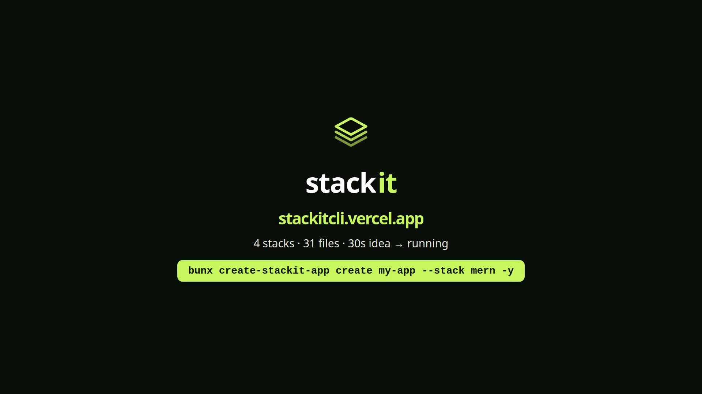

# stackit ⚡

[](https://www.npmjs.com/package/create-stackit-app)
[](https://www.npmjs.com/package/create-stackit-app)
[](LICENSE)
[](https://stackitcli.vercel.app)

Opinionated full-stack project scaffolder. Like `create-next-app`, but you pick the
whole stack — **MERN, PERN, React + Hono + Postgres, Go + Fiber, FastAPI + Next.js,
NestJS + Next.js** — and get a best-practice monorepo in one command.

Published as [`create-stackit-app`](https://www.npmjs.com/package/create-stackit-app):

```bash
bunx create-stackit-app@latest create my-app --stack mern -y
```

## Stacks

| id | frontend | backend | database |
| -- | -------- | ------- | -------- |
| `mern` | Vite + React | Express | MongoDB |
| `pern` | Vite + React | Express | PostgreSQL |
| `hono-pg` | Vite + React | Hono | PostgreSQL |
| `go-fiber` | Vite + React | Go Fiber | Postgres-ready |
| `fastapi` | Next.js (App Router) | FastAPI + SQLAlchemy 2 | PostgreSQL |
| `nestjs` | Next.js (App Router) | NestJS + TypeORM | PostgreSQL |

`fastapi` and `nestjs` are the deepest templates: argon2 hashing, JWT access +
refresh tokens (rotated and revoked), a protected `/api/auth/me`, migrations,
tests and lint — and a shared Next.js client that can actually sign up and sign in.
Python deps install with `uv` when it is on PATH, falling back to `venv` + `pip`.

```bash
bunx create-stackit-app@latest create my-api --stack fastapi -y
bunx create-stackit-app@latest create nest-api --stack nestjs -y
```

🌐 **Live site & docs: [stackitcli.vercel.app](https://stackitcli.vercel.app/)**

## What you get

Every scaffold is a monorepo, not a pile of files in one folder:

- **Layered backend** — routes, controllers, services, models, middleware and config
  live in separate files, never one growing `index.js`.
- **A frontend that runs** — Vite + React or Next.js App Router, already wired to the
  API with a working demo page.
- **Production basics** — schema validation on write endpoints, central error handling,
  env files, Docker Compose for the database, and a README that matches the code.
- **Real auth in the deep templates** — argon2 hashing, JWT access + refresh tokens
  with rotation and revocation, a guarded `/api/auth/me`, migrations and e2e tests.

## Requirements

- [Bun](https://bun.sh) >= 1.2 to run the CLI
- Node >= 20 for the JavaScript/TypeScript stacks
- Go >= 1.24 for Go + Fiber
- Python >= 3.11 for FastAPI

The CLI checks these per stack and fails fast with a helpful hint. Full per-stack
details are in [`cli/README.md`](cli/README.md).

## 🎬 Launch video

60-second demo: site tour plus a real MERN scaffold, `docker compose up`,
and a live `/api/health → {"status":"ok"}` — everything recorded, nothing mocked.

[](launch-video/stackit-launch-60s-1080p60.mp4)

[stackit-launch-60s-1080p60.mp4](launch-video/stackit-launch-60s-1080p60.mp4)
· 1920×1080, 60fps, normalized audio.

```
cli/        # the stackit CLI (Bun + TypeScript)
frontend/   # landing page + docs site (Next.js 16 + Tailwind v4)
```

## CLI — quickstart

```bash
cd cli
bun install
bun run src/index.ts create my-app --stack mern --language typescript --runtime bun --pm bun -y
```

Full CLI guide (flags, stacks, generated layouts, troubleshooting): [`cli/README.md`](cli/README.md).

## Site — landing + docs

```bash
cd frontend
bun install
bun run dev    # http://localhost:3000  ( / + /docs )
```

## Repo scripts

| Where | Command | What |
| ----- | ------- | ---- |
| `cli/` | `bun test` | 21 tests: validators + scaffold file-maps for all six stacks |
| `cli/` | `bunx tsc --noEmit` | typecheck |
| `cli/` | `bun run build` | compile to `cli/dist/stackit.js` |
| `frontend/` | `bun run dev` / `bun run build` | site dev / production build |
| `frontend/` | `bun run lint` | ESLint |

## Contributing

Issues and PRs are welcome. Before opening a PR:

```bash
cd cli
bun test && bunx tsc --noEmit

cd ../frontend
bun run lint && bun run build
```

## License

MIT © 2026 Rahul Sain. See [LICENSE](LICENSE).
